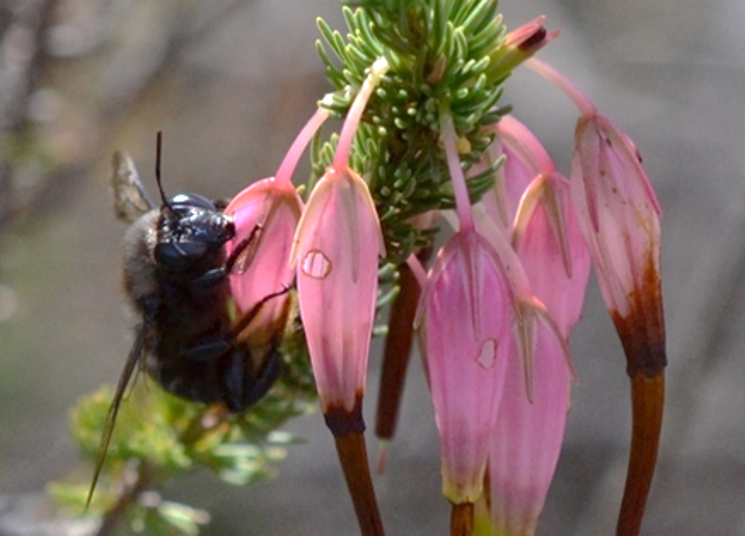
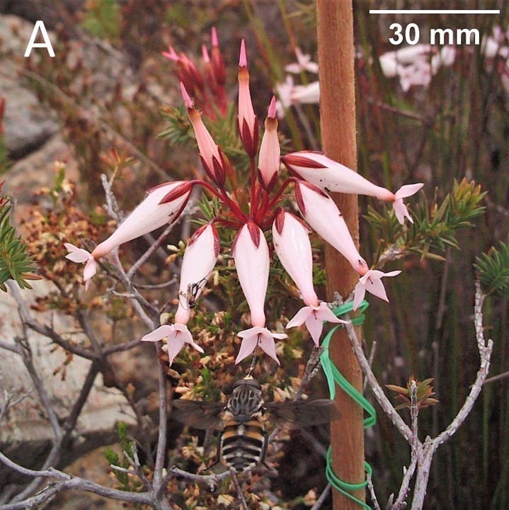
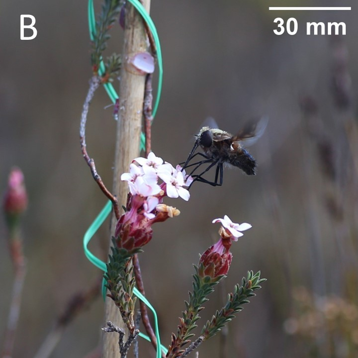

Flowers of different plant species often differ in traits, such as colour, texture, orientation, shape or anther structure. These traits can have important consequences for plant reproduction and interactions with pollinators, antagonists and the abiotic environment. These interactions in turn shape the selection pressures that drive the evolution of flowers.

## Ultraviolet colouration

  

Humans cannot see ultraviolet (UV) light, but some animals can. While most flowers have pigments that absorb UV radiation and protect them just like sunscreen, some *Erica* flowers instead reflect UV. They might be pollinated by animals that are attracted to it.

Bee-pollinated ericas normally don’t reflect UV. But all *Erica* species pollinated by long-tongued flies and 17% of sunbird-pollinated ericas reflect UV.

Long-tongued flies are specialized on drinking nectar from flowers and are important pollinators in South Africa. These flies can see UV and it is an important signal for them to visit flowers. When UV is artificially removed from the flowers, the flies stop visiting them and without visits the flowers produce no seeds.

Sunbirds can also see UV, however they have no innate preference for it. But when UV-reflecting flowers have more nectar, the birds prefer visiting them.

  

  

{fig-alt="Ultraviolet photograph of *Erica ampullacea* flowers revealing strong UV reflectance"}
{fig-alt="Ultraviolet photograph of *Erica fastigiata* flowers revealing strong UV reflectance"}

## Stickiness

  

Some *Erica* species have sticky flowers. They can even be so sticky that little 
insects get stuck to them and die. This could make them less attractive to 
pollinators, but at the same time it could also help to prevent nectar robbing.

Nectar robbing is when an animal that isn’t the legitimate pollinator pierces a 
hole in the flower and steals nectar without pollinating it. This damages the 
flower and takes nectar away from the actual pollinators. Nectar robbing is 
especially common in bird-pollinated flowers, which often produce high volumes of
nectar. The nectar also attracts insects like bees and ants. But because these 
insects have short tongues, they cannot reach the nectar legitimately and resort to 
biting holes at the base of the corolla. However, the stickier the flowers of an 
*Erica* are, the lower the risk of having their nectar robbed.

  

  

{fig-alt="Carpenter bee piercing holes into the corollas of the non-sticky *Erica plukenetii* and drinking nectar"}

## Flower orientation

  

Flowers can differ in their orientation (upwards, sideways, downwards). This
can be a result of interactions with the abiotic environment, e.g. downward orientation
can protect nectar and pollen from rain. But it could also be the result of
interactions with different pollinators. An example for this are nectar-feeding 
long-tongued flies, which have evolved in two families – Tabanidae and Nemestrinidae. 
Tabanidae have a fixed forward-pointing proboscis, which means they are 
restricted to visiting flowers orientated sideways. Nemestrinidae, on the other 
hand, can also swivel their proboscis downwards, allowing them to forage from a 
wider range of flower orientations.

In the closely related and co-occurring species *Erica shannonea* and *Erica ampullacea* flower 
orientation has even contributed to reproductive isolation. *Erica shannonea* points sideways 
and has a longer corolla. It is pollinated by a tabanid fly with a long tongue. 
*Erica ampullacea*, on the other hand, has upright flowers that are slightly 
shorter and is pollinated by a nemestrinid fly with a matching tongue. 
The tabanid fly cannot visit *E. ampullacea* because it cannot swivel its proboscis
downwards, and the nemestrinid fly cannot visit *E. shannonea* because its tongue 
is too short.

  

  

{fig-alt="Tabanid fly foraging from a sideways flower of *Erica shannonea*."}

{fig-alt="Nemestrinid fly foraging nectar from an 
upwards flower of *Erica ampullacea*."}

