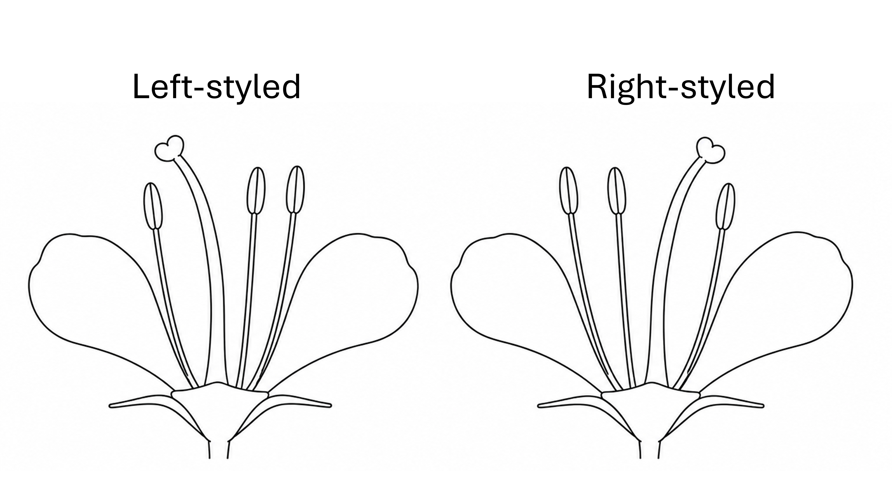
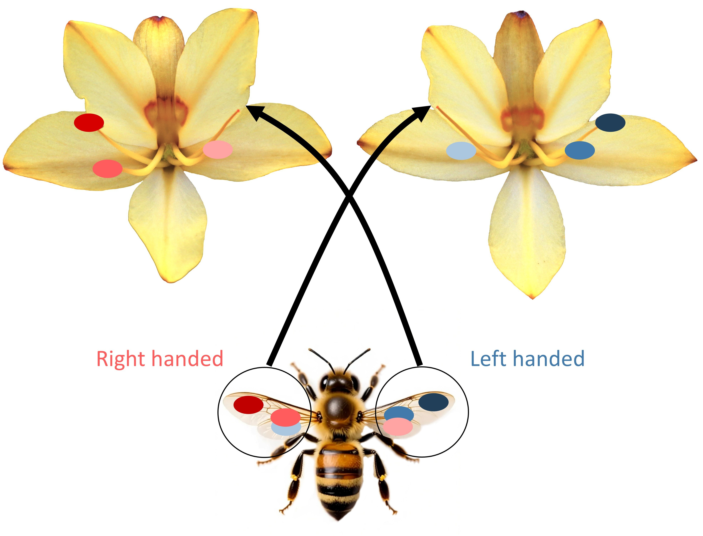
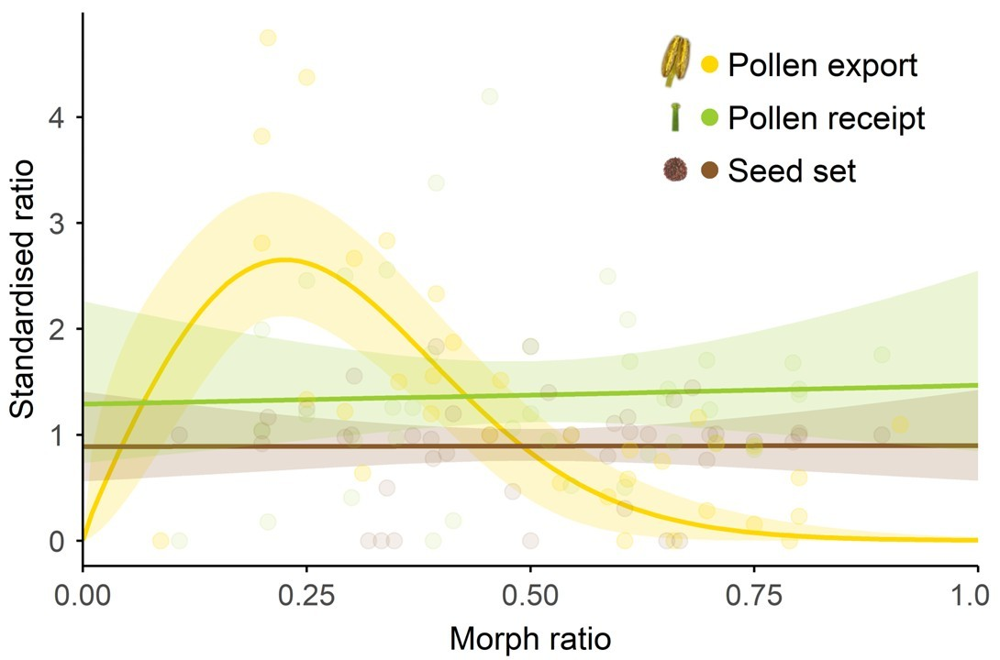
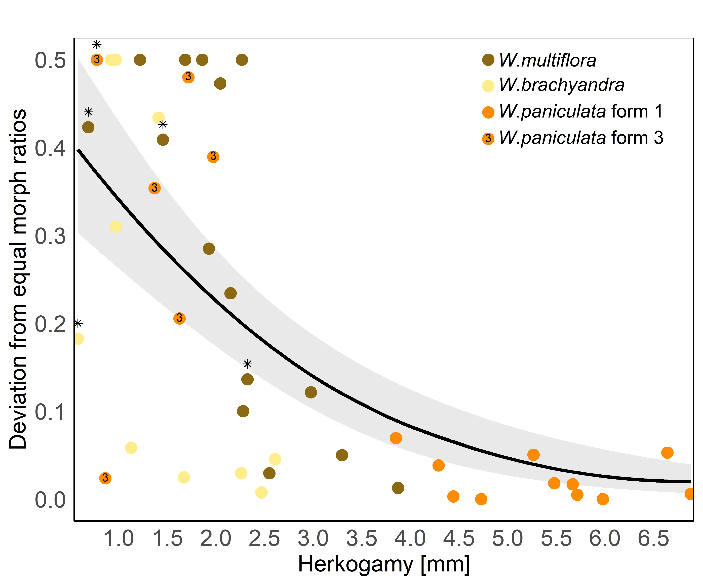

# Enantiostyly

  

Enantiostyly is a type of floral polymorphism, where the style of a 
flower is either deflected to the left or to the right, resulting in 
mirror-image flowers. This trait is rare and only 
present in less than 3% of angiosperm species. Most of the species with mirror-image
flowers are monomorphic, i.e. they produce both left and right flowers on the same
plant. But there are seven enantiostylous species which are dimorphic, meaning that each individual 
only produces one type of flower. Of these, the four species in the genus 
*Wachendorfia* as well as *Barberetta aurea* are endemic to South Africa.

  

  

{fig-alt="illustration of enantiostylous flowers with the style decflected to the left or right"}

  

## Pollen movement

  

In *Wachendorfia paniculata* and other enantiostylous plants right-handed flowers place most of their pollen on the left side of the pollinator, which will be contacted by left-handed stigmas while the majority of left-handed pollen is exported to right-handed stigmas. This leads to disassortative pollen movement, which increases cross-pollination and reduces self-pollination, even if a pollinator visits many flowers per plant.

  

  

{fig-alt="Illustration of pollen transfer between left and right flowers"}

  

## Negative frequency-dependent selection

  

  
Most populations of *Wachendorfia paniculata* have equal morph ratios between left-handed and right-handed plants. But when one of the morphs becomes rare, it has more opportunities for pollen export to potential mates. This increase in pollen export leads to negative frequency-dependent selection, i.e. the rare morph sires more offspring and has a selective advantage. This maintains both morphs in equilibrium with each other.

  
  

  

{fig-alt="Plot illustrating higher pollen export in the rare morph, but no effect of morph frequency on pollen receipt or seed set"}

  

## Breakdown of enantiostyly

  

  
Some *Wachendorfia* populations have biased morph ratios. This is especially 
common in populations with low herkogamy (= the distance 
between the stigma and the nearest anther). In the absence of pollinators, 
plants with lower herkogamy are able to self-pollinate more easily.  
When the plants reproduce via selfing, there is no disassortative pollen movement 
and no negative frequency-dependent selection. Thus, one morph can become more 
common or even take over the entire population. 

  
  

  

{fig-alt="Plot illustrating higher likelihood of biased morph ratios when herkogamy is low"}

  

